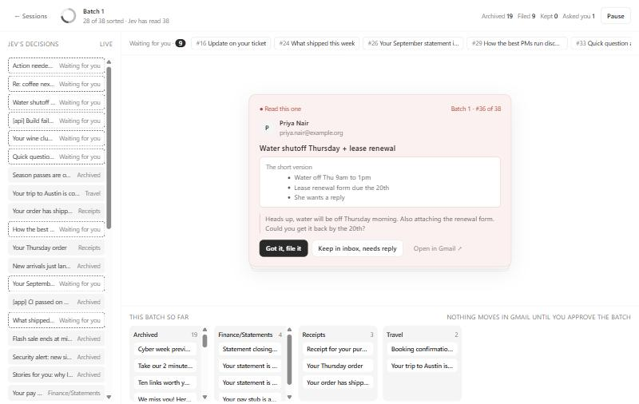
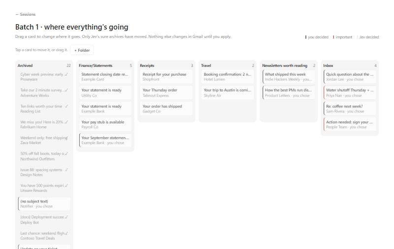

# jev-sweep

jev-sweep is a local app for going through your Gmail inbox a batch at a time. [Jev](https://typesafe.ai/), TypeSafe's decision model, scores each email. The ones it is very sure are junk get archived. For the rest it either proposes a folder or, when it is unsure or the email looks important, puts a small card in a review queue with the context and a question. You answer, and it keeps going. At the end of a batch you get a board of where everything is going, can drag cards to fix it, and then apply the moves.

It runs on your own machine against your own Gmail, TypeSafe and Anthropic accounts. Nothing is hosted.





## Quick start (fake mode)

Fake mode uses a built-in inbox and simulated answers, so it needs no accounts and no `.env`. It requires Node 22.12 or newer.

```sh
git clone https://github.com/Meerav29/jev-sweep.git
cd jev-sweep
npm install
npm run dev:fake
```

Open http://localhost:5173 and start a session. The API runs on port 8787 and listens on localhost only. Fake mode keeps its data in `data/fake.db`.

## Setup for your own inbox

Copy `.env.example` to `.env` and fill in the keys below. `.env` and `data/` are git-ignored. Then run `npm run dev` (without `:fake`) and open http://localhost:5173. `.env` is read once when the server starts, so restart after editing it.

The Setup screen is a five-item checklist: TypeSafe key, Anthropic key (optional), Google client, Gmail connected, and Folders chosen. The app stays on Setup until the four required items are done; the Anthropic key never blocks it. Choose folders (the Gmail labels Jev may file into) only works after Gmail is connected, so it is the last step.

### TypeSafe

Jev is called through TypeSafe. Create an account and an API key at [typesafe.ai](https://typesafe.ai/) and put it in `.env`:

```
TYPESAFE_API_KEY=...
```

`JEV_MODEL` is pinned to a specific version in `.env.example` (`jev-1.14.0`). Leave it pinned so the decisions do not change underneath you.

### Anthropic

This key is optional. An Anthropic key lets each review card explain why it's asking and summarize important emails; without one, cards still work, just without that text. Claude writes that helper text (details under Privacy and the generative UI section). To use it, create a key in the [Anthropic Console](https://console.anthropic.com/) and put it in `.env`:

```
ANTHROPIC_API_KEY=...
```

`CLAUDE_MODEL` picks the model (default `claude-haiku-5-5`). Claude writes a "why" line for every queued card, and a short summary only for important cards. If a Claude call fails or takes more than a few seconds, the card is shown without that text. With no key set, nothing is sent to Anthropic.

### Google

jev-sweep reads and changes your mail through the Gmail API, so you need your own OAuth client.

1. Open the [Google Cloud console](https://console.cloud.google.com/) and create a new project.
2. Enable the **Gmail API** for it.
3. Open the OAuth consent screen. Choose **External**, leave it in **Testing**, and add your own Google account as a test user.
4. Go to Credentials, create an OAuth client ID, and choose the type **Web application**.
5. Add this authorized redirect URI: `http://localhost:8787/api/auth/google/callback`.
6. Copy the client ID and secret into `.env`:

```
GOOGLE_CLIENT_ID=...
GOOGLE_CLIENT_SECRET=...
```

Press **Connect Gmail** on the Setup screen. Because the consent screen is in Testing mode, Google shows "Google hasn't verified this app". It is your own OAuth client, so choose Advanced, then Continue. The only scope requested is `https://www.googleapis.com/auth/gmail.modify`.

The app can archive, unarchive, add a label (creating it if needed), star and mark read. It never trashes, deletes or marks spam; the Gmail layer refuses any change that would add the `TRASH` or `SPAM` label.

While the consent screen is in Testing mode, Google expires refresh tokens after 7 days. When Gmail stops working, press Connect Gmail on Setup again.

Other optional settings in `.env`: `WEB_ORIGIN` (where the web app is served, default `http://localhost:5173`), `JEV_SWEEP_PORT` (default 8787), and `JEV_SWEEP_DATA_DIR` (default `data`).

Under `npm run dev` the API port is effectively fixed at 8787, because the Vite proxy in `vite.config.ts` targets it. Changing `JEV_SWEEP_PORT` also means editing `vite.config.ts` and the Google redirect URI.

## First real run

Do the first run with dry run on, so you can see what it would do before it touches your inbox. Dry run protects Gmail only: email content is still sent to TypeSafe (every email) and Anthropic (queued emails) during a dry run. See Privacy.

1. On Home, tick **Dry run (nothing changes in Gmail)**. Pick a small batch size there too, such as 10 or 20.
2. Start a session and work through the review queue, then look at the board. In a dry-run batch nothing is written to Gmail, including the archives Jev was sure about. Those cards are tagged "dry run".
3. If the decisions look right, untick dry run and start a new session.

Dry run is fixed when a batch starts, so switching it off does not turn an existing dry-run batch into a live one. In a live batch, only Jev's sure archives move in Gmail while you work. Folder moves wait until you press **Apply** on the board. Apply re-checks each thread in Gmail first and skips any that changed since the batch was fetched (a new message, or you already moved it), so it will not overwrite something you did elsewhere.

The default search is `in:inbox is:unread -category:promotions -category:social`. The query and the confidence thresholds that decide what counts as "sure" are stored in settings and are not in the UI yet; you can change them with the settings API while the server is running. Run `curl http://localhost:8787/api/settings` first to see the field names, then PUT only the fields you want to change:

```sh
curl -X PUT http://localhost:8787/api/settings \
  -H 'Content-Type: application/json' \
  -d '{"query":"in:inbox is:unread"}'
```

This single-quoted form works in Git Bash, WSL, macOS and Linux. In PowerShell:

```powershell
Invoke-RestMethod -Method Put -Uri http://localhost:8787/api/settings `
  -ContentType 'application/json' -Body '{"query":"in:inbox is:unread"}'
```

## How it decides

For each email, Jev answers a set of questions (is it junk, is it a notice whose moment has passed, is someone waiting on me, does it involve money, was a person likely to have written it) and picks where it belongs. [`server/policy/decide.ts`](server/policy/decide.ts) turns those answers into one of three outcomes, checked in this order:

1. **Old notices are archived, even if they once looked important.** Automated mail that is at least `staleDays` old and that Jev is sure no longer matters (a shipping notice for a parcel that arrived, a login code, an event that already happened) is archived. This rule runs before the importance check, because an old notice can still look important in isolation. It does not apply if anyone looks to be waiting on a reply, or if money is involved.
2. **Anything a person is waiting on goes to you.** Important mail and mail that needs a reply become review cards, unless the stale rule above applies. They are not archived by any other rule.
3. **Very-sure junk leaves the inbox.** If Jev is very sure the email is junk, is less than 30% sure anyone is waiting on a reply, and does not want it kept (its chance of "keep" is at most `junkMaxKeep`, and it has to give a keep figure at all), it is archived. If Jev is also sure of one folder (confidence at least `proposeConfidence`), the email is proposed for that folder instead; the move happens only when you press Apply. Similar folders split Jev's vote, so a weak folder pick means archive. If Jev's own pick is to keep the email, this rule never archives it.

Money problems (a failed payment, a bill due), mail a person may be waiting on (both the stale and junk rules require a needs-reply chance under 30%), and anything that reads as human-written are protected under every rule. Mail Jev rates important is never archived by the junk or triage rules, but an old notice whose moment has passed can still be archived by the stale rule. Everything that no rule is sure about waits for you as a card: confident folder picks are proposed, the rest are asked.

The thresholds, with their defaults:

| Setting | Default | Meaning |
| --- | --- | --- |
| `staleDays` | 14 | Age in days before the old-notice rule can apply |
| `staleConfidence` | 0.85 | How sure Jev must be that the notice is stale |
| `junkMaxKeep` | 0.15 | Highest "keep" probability at which the junk rule still archives or proposes |
| `autoArchiveConfidence` | 0.85 | Confidence needed to archive on Jev's pick of the archive destination |
| `proposeConfidence` | 0.6 | Confidence needed to propose a folder |
| `importantQueue`, `needsReplyQueue` | 0.7 | Chance of important / needs reply that makes a card |
| `guardNoul` | 0.5 | Money, human-written or important at this level blocks automatic archiving and proposals |
| `recentDays` | 7 | Mail younger than this needs a stricter bar to be archived |

See them with `curl http://localhost:8787/api/settings` and change any of them with `PUT /api/settings`, sending only the ones you want under `thresholds` (the rest keep their values):

```sh
curl -X PUT http://localhost:8787/api/settings \
  -H 'Content-Type: application/json' \
  -d '{"thresholds":{"staleDays":21,"junkMaxKeep":0.1}}'
```

Typing "Archive" as a folder name anywhere means the archive action, not a label called Archive.

## How the generative UI works

The cards are not free-form model output. Jev's answers go through three fixed steps, and only the middle one describes a card.

1. [`server/policy/decide.ts`](server/policy/decide.ts) takes the Jev answers for one email (the destination choice with its confidence, plus probabilities such as `important`, `needs_reply`, `bulk_marketing`) and your thresholds, and returns an outcome: `auto_archive`, `proposed` (a folder, applied only after you approve the board), or `queue` with a card kind (`filing` or `important`). It is a plain function and is tested without any network.
2. [`server/cards/toCard.ts`](server/cards/toCard.ts) turns a `queue` outcome into a typed `CardSpec`: sender, subject, a trimmed body, up to three destination options ranked by Jev's probabilities, the optional Claude text, and a link to the thread in Gmail.
3. [`web/cards/registry.tsx`](web/cards/registry.tsx) maps `CardSpec['kind']` to a hand-written React component. The browser can only draw cards that exist in that registry; the model never produces markup.

Claude's part is limited to the optional one-sentence `why` (every queued card) and summary bullets (important cards only) in `CardSpec`. If they are missing, the card still renders.

## Privacy

Everything runs on your machine. The server listens on `127.0.0.1` only, and the API keys and the Gmail token stay in the server process. The browser never receives them.

Stored locally:

- `data/jev-sweep.db` (SQLite; `data/fake.db` in fake mode). Per email: thread and message IDs, sender name and address, subject, date, Gmail labels and the unread flag. Also Jev's answers, the card text Claude wrote, your decisions, the review queue, your folder list and your settings. **Email bodies are not stored.** They are fetched, used in memory and dropped.
- `data/google-token.json`, your Google OAuth tokens, written with mode 600 where the platform supports it.
- `.env`, which you create.

Sent to TypeSafe (Jev), for every email in a batch: sender name and address, subject, date, age in days, Gmail labels, the first 2,000 characters of the body, and the names and descriptions of your enabled folders. The questions it is asked are in [`server/jev/questions.ts`](server/jev/questions.ts).

Sent to Anthropic, only for emails that end up in the review queue (not the ones archived or proposed automatically): subject, sender name and address, the first 2,000 characters of the body, and Jev's top two destinations with the confidence. See [`server/claude/cardText.ts`](server/claude/cardText.ts).

Sent to Google: the Gmail API calls needed to list, read and modify your threads.

Check the data-handling terms of TypeSafe and Anthropic yourself before pointing this at a mailbox with sensitive mail. To remove everything jev-sweep keeps, delete the `data/` folder and revoke the app at https://myaccount.google.com/permissions.

## License

MIT. See [LICENSE](LICENSE).
